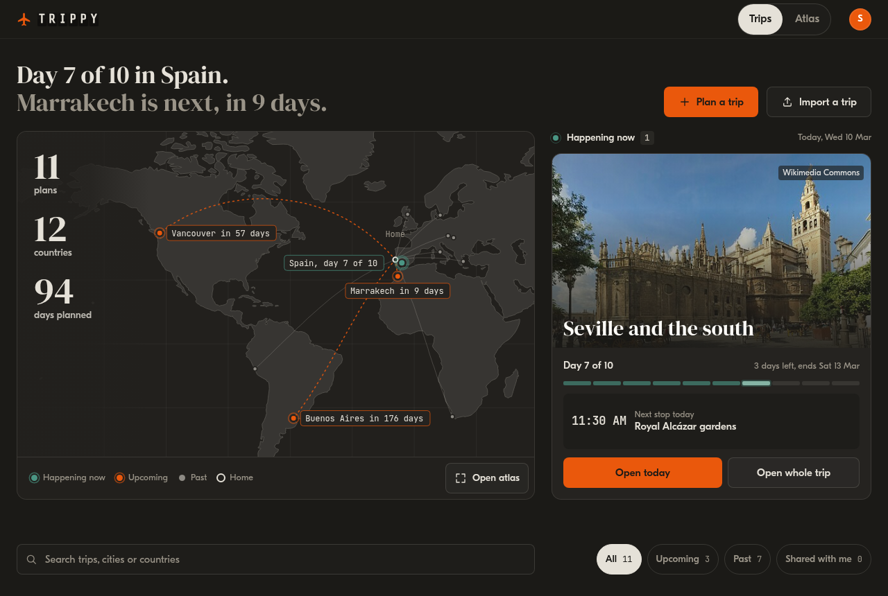
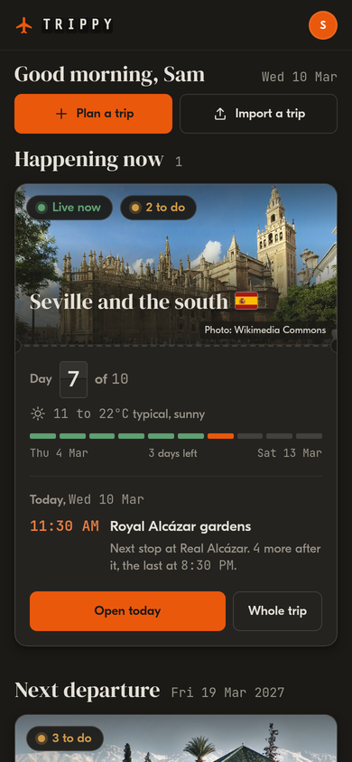
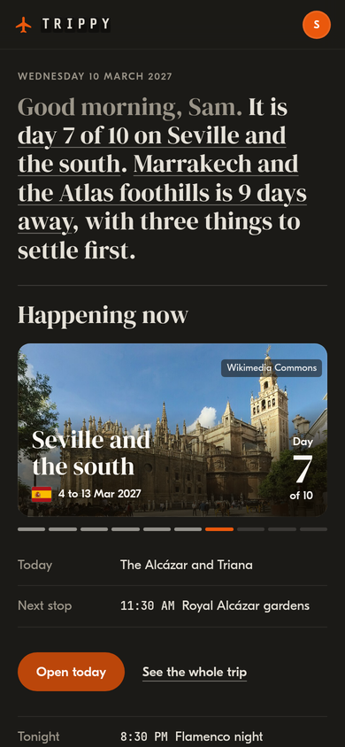
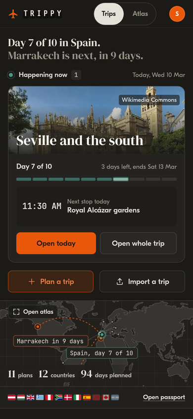
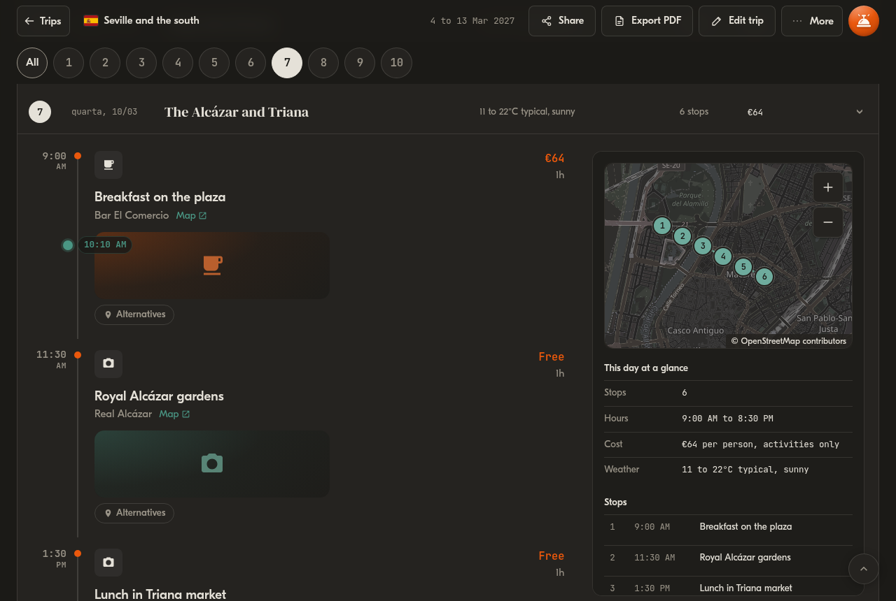
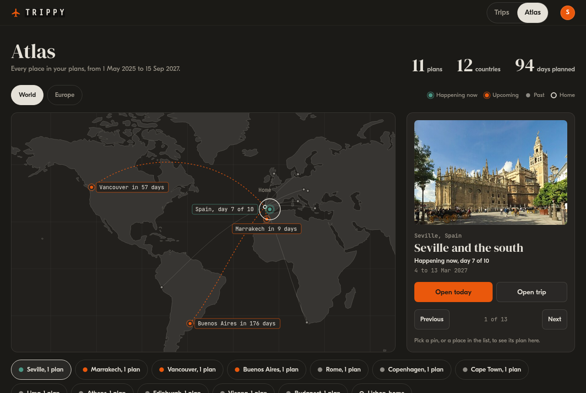
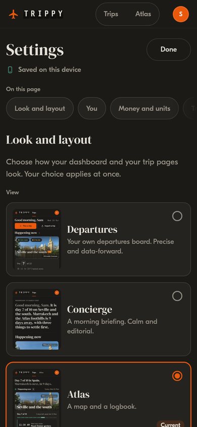

<p align="center">
  
</p>

<h1 align="center">Trippy</h1>

<p align="center">
  Trip planner that plans the whole thing for you, day by day.<br>
  <a href="https://chuatzeyee.github.io/TrippyPWA/">chuatzeyee.github.io/TrippyPWA</a>
</p>



I started Trippy because planning our own trips out of Singapore always ended up as ten browser tabs, one messy Notes file and a WhatsApp chat full of links. So now you tell it where, when, how much you want to spend and how you like to travel, and it gives you back a proper plan: real places, timings, how to get from one to the next, flights or ferry, hotels, and what you need to book early.

The defaults lean Singapore (SGD, Scoot, weekend trips to Batam or Desaru and so on) but it works for anywhere.

Plain JavaScript, Vite and Supabase. No React, no framework. Installable as a PWA, and there is an Android wrapper also.

<sub>All the screenshots here use a made up demo account (Sam, based in Lisbon, ten days in Seville). None of it is a real booking.</sub>

---

## Pick your own look

The dashboard and trip pages come in three views. You choose one in Settings and it follows you to every device you sign in on.

<table>
  <tr>
    <td width="33%"></td>
    <td width="33%"></td>
    <td width="33%"></td>
  </tr>
  <tr>
    <td align="center"><b>Departures</b><br>Like an airport board. Numbers first.</td>
    <td align="center"><b>Concierge</b><br>Reads like a morning briefing.</td>
    <td align="center"><b>Atlas</b> (default)<br>A map plus a logbook.</td>
  </tr>
</table>

All three show the same things: the trip happening now and which day you are on, the next one coming up, what you still need to settle before you fly, and the rest of your trips with search and filters.

---

## What it can do

### Plan a trip

A short wizard, seven steps:

1. **Where to?** Search any of 2,000 cities, or plan a route across a few. City not in the list? Type it and pick "Use {city}".
2. **When?** How many of you, and exact dates or just a rough length and season. For overseas trips it also asks which passports the group holds, so it can tell you the right visas and arrival cards.
3. **Comfort.** Backpacker, comfortable or luxury, plus a daily budget in the local currency.
4. **Where to stay.** Hotel type, stars, what matters to you. Already booked? Turn on "Already Settled" and it skips this.
5. **Getting there.** Fare class, departure time, how many stops is OK. If you already bought the tickets, key in the flight number, the route with any stopover (like `SIN > TPE > CTS`) and the local times. Day 1 then starts after you land, not before.
6. **Travel style.** Sliders for pace, food, nightlife and exploring, plus interests (UNESCO sites is one of them).
7. **Summary.** Check everything on one screen. You can paste in your own research too, like places you must go or things you already booked, and the plan works around them.

For nearby places (Singapore to Batam, or Singapore to JB and KL) there is no point showing flights, so that step becomes ferry, train or bus instead. It works this out from your home city and how far each stop is.

After you send it, a popup shows the plan coming in live: a line from your home to the destination, lighting up one day at a time. A 10 to 14 day trip takes about 5 minutes. You can close the popup and get notified when it is ready.

### What you get back

- Day by day plan with times, real venue names, addresses, tips and costs
- How to get from one stop to the next
- Flights from your actual home city with every stopover, or ferry, bus and train for nearby trips (where to board, where to change, the border crossing, door to door time)
- Multi-city trips in a sensible order, not just the order you typed
- Hotels per city, marked Recommended, Best Value and so on
- A booking checklist split into "Must Book Ahead" and "Good to Book"
- Typical weather for each day, and real ways to save money (passes, free entry days)
- No repeated restaurants across the trip

### The trip page



- Day bar along the top, and each day opens with its own map and a quick summary
- On the day itself, a marker on the timeline shows where you should be now
- Flight cards that look like a boarding pass (route, airline, booking ref, seats, baggage)
- Transport card for bus, train, ferry and car trips, with numbered steps if you need to change, and links to Google Maps and Rome2Rio
- **Entry requirements** for every country, every transit stop and every passport in the group: visa or not, plus the arrival cards and fees to settle before you go (Visit Japan Web, SG Arrival Card, MDAC, All Indonesia, K-ETA, ESTA, UK ETA and others). Each one says when and how, links only the official site, and you tick them off as you go. Researched from official sources in Nov 2026, data is in `public/data/visa/entry-steps.json`.
- Hotels per city with links to Booking.com, Agoda and Google Hotels
- Reader view, PDF export, 12 or 24 hour time, Celsius or Fahrenheit

### Trippy Concierge

The bell button on any trip opens a chat that has read your whole plan: tips, addresses, durations, budget, weather for each day. Ask it things like "what time should we leave for the airport on day 10?" or tell it "make day 3 more relaxed". Changes come back as a diff and nothing is saved until you press Apply. It can also note down bookings, change where you stay, and add notes to stops.

### Already planned it yourself?

- **Import a Word document or pasted text.** Drop in your `.docx` or paste the plan from Notes, ChatGPT or wherever. It gets turned into a proper trip that you check before saving. Flight numbers, booking refs, seats, baggage and hotel dates come along.
- **Import JSON.** Still there under Advanced, with a prompt you can give any AI. The parser is forgiving, so slightly broken JSON still goes through, and there is undo.
- **Compare with Trippy.** Got an imported plan? Ask Trippy to plan the same place, dates and people, then see both side by side, day by day. Places in both are marked, you can copy a stop across, and at the end you keep yours or keep both.

### Edit, share, plan together

- Edit mode to change, delete or add stops. Place search uses Photon (OpenStreetMap) and walking time is worked out with OSRM.
- "Alternatives" on any stop gives three real nearby swaps.
- Regenerate is safe. If the new plan fails halfway, your old one is still there.
- Share link per trip, read only, no login needed. Links expire after 7 days and you can revoke anytime.
- Invite people by email as viewer or editor. When someone edits, everyone with the trip open sees it change.

### Atlas



Every place across all your trips on one map: what is happening now, what is coming, where you have been. Pick a pin or a place to see that trip.

### Settings



- Choose the view (Departures, Concierge or Atlas) and dark or light theme
- Your name, home city and currency
- Time format and temperature unit
- Synced to your account, so your phone and laptop match
- Delete your own account and everything in it, no need to email anyone

<br clear="right">

### Photos

Every stop gets a real photo of that place where possible. Sources, in order: Google Maps listings through Serper, the venue's own website, OpenStreetMap and Wikidata, Wikipedia (must be geotagged within 1 km), Wikimedia Commons and Openverse. Photos from the web are checked by Gemini to make sure they really show the place. Logos, banners and tiny thumbnails are thrown out. If nothing good turns up, you get a designed placeholder instead of some random stock photo. Credits (who took it, licence, source) are on every photo.

### Site pages

Footer with About, Privacy policy (written for Singapore's PDPA) and Terms of use (Singapore law), in English, Bahasa Melayu, Simplified Chinese and Finnish. Trippy is free and experimental. It does not sell tickets or take commission.

### Admin

`#/admin`, only for accounts with `role = 'admin'`. An operator's console with the numbers (users, trips, generations, errors), user and trip management, and logs you can filter and purge.

### Square screens and Android

- On a near square phone like the Unihertz Titan 2, long pages turn into swipeable cards. Turns on by itself, or force it on or off.
- There is a TWA (Trusted Web Activity) wrapper built with Bubblewrap and sideloaded. It runs the live site full screen, so a web deploy updates the app also. Steps are in `DEVELOPMENT.md`.

### Accessibility

- Visible focus ring on every control, and everything works with the keyboard
- Text contrast meets WCAG AA in dark and light
- Animations respect `prefers-reduced-motion`
- Icon buttons have proper labels, and status is never shown by colour alone
- Pinch zoom is never disabled

---

## How the AI part works

Gemini 3.6 Flash plans the trip. If it is busy or fails, Gemini 3.5 Flash-Lite takes over, then Mistral's Ministral 8B as the last resort.

Supabase free tier kills an edge function at about 150 seconds, and a packed 11 day trip is around 90 stops. One model call cannot finish that in time. So generation runs as a small job queue:

1. The app adds a row to `generation_jobs`, listens to the trip through Realtime, and kicks off the `process-generation` worker once.
2. The worker plans about four days per call, then calls itself for the next chunk. Each call is sized to the time left, so a slow model cannot get the worker killed halfway.
3. The first chunk also does the trip level things: flights or transport, hotels, booking checklist, money saving tips. If a reply gets cut off, the complete days are kept and the rest is done next round.
4. When the last chunk is done, everything is saved in one transaction through the `replace_itinerary` RPC. If that fails, your old plan stays.
5. If a worker dies, a `pg_cron` job (`dispatch_stale_generations`, every minute) picks it up from the last finished chunk. Only the newest job of a trip can write to it, so Retry never fights an older run.

---

## Running it locally

```bash
npm install
cp .env.example .env.local   # put your Supabase URL and anon key here
npm run dev
```

Open `http://localhost:5173`. Tests:

```bash
npm test
```

### Env vars

Frontend (`.env.local`):

| Variable | What it is |
|----------|------------|
| `VITE_SUPABASE_URL` | Supabase project URL |
| `VITE_SUPABASE_ANON_KEY` | Supabase anon key |

Edge functions (Supabase secrets):

| Variable | What it is |
|----------|------------|
| `GEMINI_API_KEY` | Main AI provider, also checks photos |
| `MISTRAL_API_KEY` | Last resort AI provider (`ministral-8b-latest`) |
| `SERPER_API_KEY` | Optional. Venue photos from Google Maps listings |
| `TAVILY_API_KEY` | Optional. Venue photos from the web |
| `PEXELS_API_KEY` | Optional. Trip cover photos |
| `MAPILLARY_TOKEN` | Optional. Street level photos |
| `ALLOWED_ORIGINS` | Optional. Comma separated CORS allowlist for the proxies |

No Google Maps or Places API key needed. Maps, search and walking directions all use free OpenStreetMap based services.

---

## Stack

| Part | What I used | Why |
|------|-------------|-----|
| Frontend | Vanilla JS, ES modules | Small bundle, nothing to upgrade every few months |
| Build | Vite 8 | Fast dev server |
| Styling | CSS custom properties | Tokens, no preprocessor |
| Backend | Supabase | Postgres, Auth, Edge Functions (Deno), RLS, Realtime, pg_cron |
| Login | Google OAuth through Supabase | |
| AI | Gemini 3.6 Flash, then 3.5 Flash-Lite, then Ministral 8B | Structured JSON output |
| Maps | Leaflet with OpenStreetMap tiles | Free, no key |
| Place search | Photon (OpenStreetMap) | Free, no key |
| Walking directions | OSRM | Free, no key |
| Routing | Hash routes (`#/trip/:id`) | Works on GitHub Pages without server rewrites |
| Tests | Vitest | |
| Deploy | GitHub Actions to GitHub Pages, on every push to `main` | |

### Security

- Row Level Security on every table
- Shared trips are read through the `get_shared_trip` RPC, so nobody can list other people's trips or share links
- `replace_itinerary` can only be called by the worker's service role
- Edge proxies need a valid login, have a CORS allowlist and timeouts
- All user text goes through `escapeHtml()` before it touches `innerHTML`
- Outside URLs (venue websites, photo sources) go through an SSRF check
- Database is in Singapore (`ap-southeast-1`). Logs are kept up to one year, then deleted automatically.

---

## Design

The classic look is called "Dark Lounge": warm charcoal background, colour from the cards and accents, a bit like reading a travel magazine at night. There is a light theme too.

| Token | Value | Used for |
|-------|-------|----------|
| `--parchment` | `#1B1A17` | Page background |
| `--surface-solid` | `#252320` | Cards |
| `--ink` | `#E5E1D8` | Main text |
| `--ink-secondary` | `#9A9488` | Secondary text |
| `--terracotta` | `#EA580C` | Main accent, buttons, selected states |
| `--teal` | `#4A9684` | Links, today marker |
| `--amber` | `#D09A48` | Highlights, travel time, booked badge |
| `--sage` | `#5FA072` | Progress, success |
| `--error` | `#C85252` | Errors, failed trips |

Fonts: DM Serif Display for headings, Figtree for body, JetBrains Mono for prices, times and codes. Spacing on a 4px scale. Full list in `css/tokens.css`.

---

## More docs

- `DEVELOPMENT.md`: project layout, deploying, edge functions, database, Android app
- `docs/history/`: how Trippy looked over time
- `docs/trip-import-format.md`: the JSON import format
- `ARCHITECTURE.md`: older design notes from the early version

---

Made in Singapore by [Chua Tze Yee](https://github.com/chuatzeyee).
