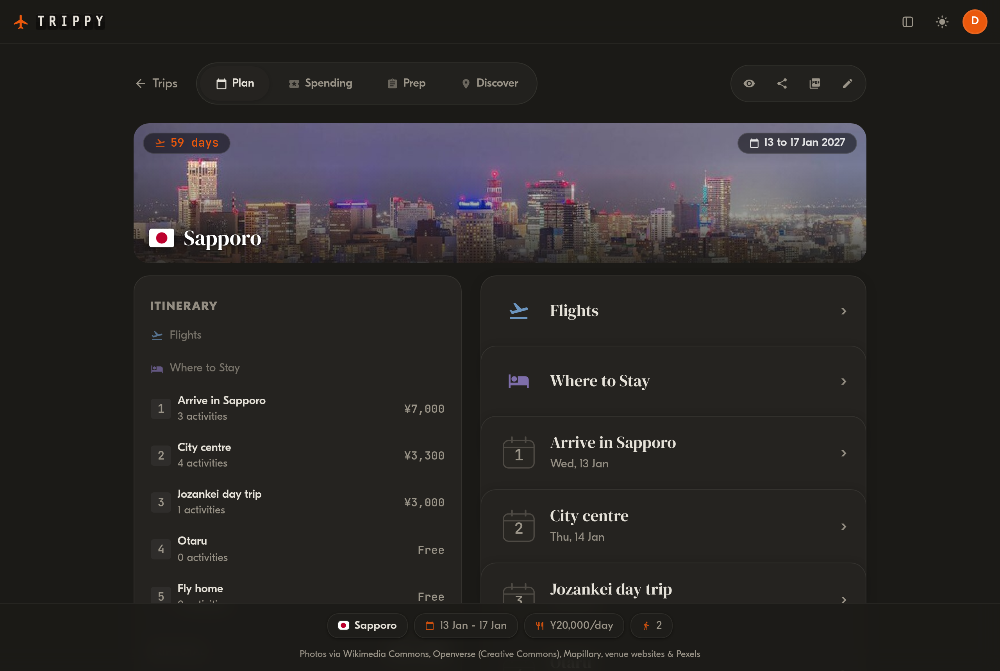
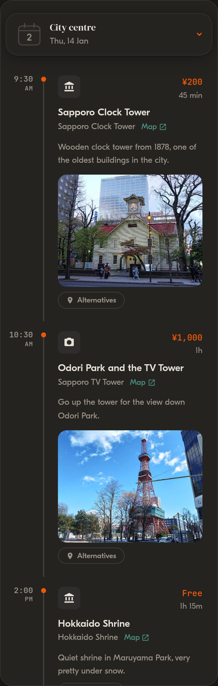
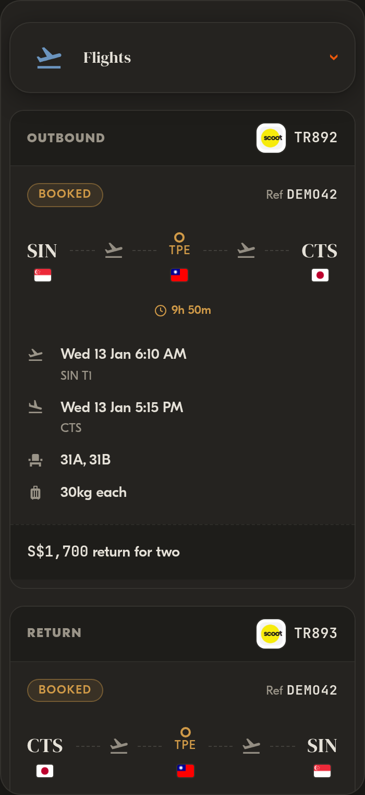

<p align="center">
  
</p>

<h1 align="center">Trippy</h1>



<table>
  <tr>
    <td width="50%"></td>
    <td width="50%"></td>
  </tr>
  <tr>
    <td align="center">A day in the plan</td>
    <td align="center">Booked flight card</td>
  </tr>
</table>

<sub>Screenshots use a made up demo trip, not real bookings.</sub>

Travel planner PWA. You go through a short wizard (where, when, budget, how you like to travel), and Gemini 3.6 Flash plans the whole trip day by day: real venues, how to get between them, flights or ferry, hotels, what to book early. If it is busy or fails, Gemini 3.5 Flash-Lite takes over, then Mistral.

Started this for our own trips out of Singapore, so the defaults lean that way (SGD, nearby spots like Batam and Desaru, Scoot flights and so on). Works for anywhere though.

Plain JS + Vite + Supabase. No React, no framework.

**Live:** https://chuatzeyee.github.io/TrippyPWA/ (GitHub Pages, deploys on every push to `main`)

---

## Running it locally

```bash
npm install
cp .env.example .env.local   # put your Supabase URL and anon key here
npm run dev
```

Then open `http://localhost:5173`.

Tests:

```bash
npm test
```

### Env vars

Frontend (`.env.local`):

| Variable | What it is |
|----------|------------|
| `VITE_SUPABASE_URL` | Supabase project URL |
| `VITE_SUPABASE_ANON_KEY` | Supabase anon key |

Edge functions (Supabase secrets):

| Variable | What it is |
|----------|------------|
| `GEMINI_API_KEY` | Main AI provider |
| `MISTRAL_API_KEY` | Backup AI provider |
| `PEXELS_API_KEY` | Optional. Stock photo fallback when Wikipedia has nothing |
| `MAPILLARY_TOKEN` | Optional. Street view photo as the last resort |
| `ALLOWED_ORIGINS` | Optional. Comma separated CORS allowlist for the proxies |

No Google Maps or Places key needed anymore. Search, directions and photos all use free sources now (see below).

---

## Stack

| Part | What I used | Why |
|------|-------------|-----|
| Frontend | Vanilla JS, ES modules | Small bundle, nothing to upgrade every few months |
| Build | Vite 8 | Fast dev server |
| Styling | CSS custom properties | Token based, no preprocessor |
| Backend | Supabase | Postgres, Auth, Edge Functions (Deno), RLS, Realtime |
| Login | Google OAuth through Supabase | |
| AI | Gemini 3.6 Flash, then 3.5 Flash-Lite, then Mistral | Structured JSON output |
| Place search | Photon (OpenStreetMap) | Free, no key |
| Walking directions | OSRM | Free, no key |
| Photos | Wikipedia, Wikimedia Commons, Openverse, Pexels, Mapillary | Free, with credits shown |
| Routing | Hash routes (`#/trip/:id`) | Works on GitHub Pages without server rewrites |
| Tests | Vitest | |
| Deploy | GitHub Actions to GitHub Pages | |

---

## What it does

### Planning wizard

Seven steps:

1. **Where to?** One city or a multi-city route. If your city is not in the list, just type it and pick "Use {city}".
2. **When?** Number of travellers, exact dates or a rough duration and season.
3. **Comfort level.** Backpacker, comfortable or luxury, plus a daily budget in the local currency.
4. **Where to stay.** Hotel type, star rating, what matters to you. Already booked? Toggle "Already Settled" and it skips.
5. **How to fly.** Fare class, preferred departure time, connections. Same "Already Settled" toggle.
6. **Travel style.** Sliders for pace, food, nightlife, exploring, plus interest chips.
7. **Summary.** Everything on one screen. You can also paste your own research here (places you must go, things you already booked) and the AI will plan around it.

For nearby places (say Singapore to Batam), the flights step is swapped for ferry, train or bus. It works this out from your home city and the distance.

### Itinerary generation

Long trips used to die halfway because Supabase free tier edge functions get killed around 150 seconds. An 11 day packed trip is about 90 activities, one model call cannot finish that in time. So generation runs as a job queue, a few days at a time:

1. The app creates a row in `generation_jobs`, listens on the trip row through Realtime, then kicks off the `process-generation` worker once.
2. The worker does one chunk (about four days) per call, then calls itself for the next chunk. Each chunk tries Gemini 3.6 Flash first, then 3.5 Flash-Lite, then Mistral. Every call is sized to fit the time left in that run, so a slow model cannot get the worker killed halfway.
3. The first chunk also does the trip level stuff: flights or transport, hotels, booking checklist, money saving tips. If a reply gets cut off, the complete days in it are kept and the rest is generated next pass. A restaurant repeated from an earlier day is dropped instead of failing the chunk.
4. When the last chunk is done, everything is saved in one transaction through the `replace_itinerary` RPC. If the save fails, your old itinerary is still there. Regenerate never wipes a trip unless the new one actually commits.
5. The app sees the status change through Realtime and updates. If a worker dies halfway, a `pg_cron` job (`dispatch_stale_generations`, every minute) starts it again from the last finished chunk, so nobody needs to reload. Only a trip's newest job can write to it, so a Retry never fights an older run. Retry also picks up from the days already done.

What you get back:

- Day by day plan with times, real venue names, addresses, coordinates, tips and costs
- A short "how to get there" line between activities
- Flights from your actual home city, or ferry, bus and train options for nearby trips
- Multi-city routing in a sensible order (not just the order you typed)
- Hotels per city, tagged Recommended, Best Value and so on
- Booking checklist split into "Must Book Ahead" and "Good to Book"
- Weather per day and real savings tips (passes, free entry days and the like)
- No repeated restaurants across days

### Importing a trip you already planned

Already planned everything in ChatGPT or a spreadsheet? Use the import. It is a four step guide: copy the prompt it gives you, paste it into any AI with your notes, paste the result back, check the preview, done. The parser is lenient, so slightly broken JSON still goes through. There is undo if the import is not what you wanted.

Imported trips can carry real bookings: flight numbers, booking refs, seats, baggage, hotel check in and check out per stay, and booking deadlines.

### Trip page

- Day tabs with weather
- Activity cards with time, venue, notes, cost and a photo
- Flight cards in a boarding pass style: route with stopovers, airline logo, booking ref, depart and arrive times, seats and baggage
- Hotels per city with booking links (Booking.com, Agoda, Google Hotels)
- Booking checklist with deadlines
- Live tracking: on the day itself there is a marker on the timeline showing where you should be now
- Reader view: a clean read only layout of your own trip
- PDF export
- All times shown in 12 hour format (6:10 AM, 7:30 PM). Stored as 24 hour in the database.

### Editing

- **Edit mode.** Change, delete or add activities. Venue search uses Photon, and walking distance is recalculated with OSRM after you save.
- **Alternatives.** Tap "Alternatives" on any activity and you get three real nearby swaps. Tap one to replace it.
- **Trippy Concierge.** Chat panel on the trip page. Tell it things like "make day 3 more relaxed" and it proposes changes as a diff. Nothing is saved until you press Apply.
- **Regenerate.** Reruns the whole plan. Safe to use, the old plan stays if anything fails.

### Sharing and collaboration

- Share link per trip, read only at `#/shared/:token`, no login needed. Revoke anytime.
- Invite people by email as viewer or editor. When someone edits, everyone with the trip open sees it update.

### Photos

Every venue gets a real photo where possible, in this order: the venue's own website, OpenStreetMap and Wikidata links, Wikipedia (must be geotagged within 1km), Wikimedia Commons, Openverse, then Mapillary street view. Logos, banners and tiny thumbnails are rejected. If nothing trustworthy is found, it shows no photo instead of a random stock image. Photo credits (creator, licence, source) are shown on each photo.

Trip header covers are picked from Wikidata, Wikimedia featured and quality images, and Pexels (only if the photo actually names the city). The candidates are ranked, and Gemini can do a final check that the photo really shows the place.

### Admin

`#/admin`, only for users with `role = 'admin'`.

- Overview numbers: users, trips, generated, admins, errors
- Users: search, sort, change role
- Trips: see, regenerate or delete any trip
- Logs: filter by level, category and source, auto refresh, purge anything older than 90 days

### Login and security

- Google login through Supabase Auth, profile set up on first sign in (name, home city, currency)
- Row Level Security on every table
- Shared trips are read through the `get_shared_trip` RPC, so anonymous users cannot list trips or shares
- `replace_itinerary` can only be called by the service role worker
- Edge proxies need a valid login, have a CORS allowlist and timeouts
- All user text goes through `escapeHtml()` before it touches `innerHTML`
- External URLs (venue websites, photo sources) go through an SSRF check

### Square screen mode

For square phones like the Unihertz Titan 2. Long scrolling pages turn into swipeable cards. Turns on automatically on a near square screen, or you can force it on or off from the nav.

### Android app

There is a TWA (Trusted Web Activity) wrapper in `../trippy-android`, built with Bubblewrap and sideloaded. It just runs the live site in full screen Chrome, so a web deploy updates the app also. Setup steps are in `DEVELOPMENT.md`.

### Accessibility

- Visible focus ring on every control
- Coverflow, calendar and accordions all work with the keyboard
- Text contrast meets WCAG AA in dark and light themes
- Animations respect `prefers-reduced-motion`
- Icon buttons have proper labels, and status is never shown by colour alone

---

## Design

Called it "Dark Lounge". Warm charcoal background, colour comes from the cards and accents, a bit like reading a travel magazine at night. There is a light theme too (`[data-theme="light"]`).

| Token | Value | Used for |
|-------|-------|----------|
| `--parchment` | `#1B1A17` | Page background |
| `--surface-solid` | `#252320` | Cards |
| `--ink` | `#E5E1D8` | Main text |
| `--ink-secondary` | `#9A9488` | Secondary text |
| `--ink-ghost` | `#938D82` | Faint text (still AA on cards) |
| `--terracotta` | `#EA580C` | Main accent, buttons, selected states |
| `--teal` | `#4A9684` | Links, today marker |
| `--amber` | `#D09A48` | Highlights, travel time, booked badge |
| `--sage` | `#5FA072` | Progress, success |
| `--plum` | `#7E6EAA` | Sharing |
| `--error` | `#C85252` | Errors, failed trips |

Fonts: DM Serif Display for headings, Figtree for body, JetBrains Mono for prices, times and codes. Spacing is on a 4px scale. Full token list in `css/tokens.css`.

---

## Destinations

124 curated cities, each with country, flag, coordinates, currency, timezone and daily budget ranges. Quite a few are short trips from Singapore (Genting, Cameron Highlands, Batam, Bintan, Desaru, Krabi, Koh Samui, Da Nang). Any other city can be added by name and the AI will figure out where it is.

---

## PWA

- Installable, with `manifest.json` and icons
- Service worker for offline caching
- In standalone mode the nav bar hides and the safe areas are handled, so nothing sits under the notch or home bar
- Pinch zoom is not disabled

---

## More docs

- `DEVELOPMENT.md`: project layout, deploying, edge functions, database, Android app
- `ARCHITECTURE.md`: older design notes from the early version
