# How Trippy has looked

Trippy is an AI travel planner that runs in the browser. This page follows how it has looked from its first commit on 18 May 2026 to 22 November 2026, through 18 milestones picked from the commit history.

Each milestone has a short note on what changed and a few screenshots. The notes are taken from the commit messages. The trips in the pictures are invented sample data.

There is also a [single page version](index.html) of this history that is nicer to scroll.

## Then and now

<table><tr>
<td width="50%"><a href="images/2026-05-18-c7caadb-dashboard-desktop.webp">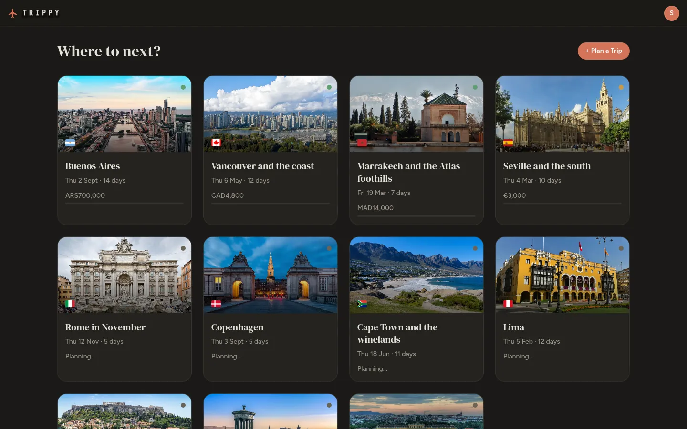</a> 18 May 2026: the dashboard at the first commit.</td>
<td width="50%"><a href="images/2026-11-22-3a5e170-dashboard-desktop.webp">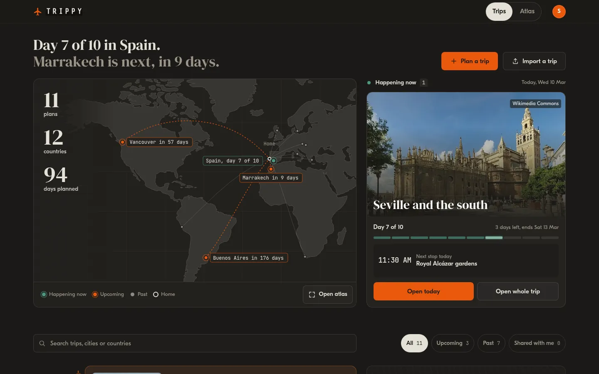</a> 22 November 2026: the dashboard today.</td>
</tr></table>

## The first week

*18 to 23 May 2026*

Trippy went from a first commit to a working planner with an admin portal, sharing and PDF export in six days. The look changed almost daily: the accent colour, the landing page, the trip page and the wizard were all redone at least once.

### First commit: the terracotta Trippy

**18 May 2026** (`c7caadb`)

The first commit was already a complete small app: a landing page, a seven step wizard, a dashboard of trip cards and a trip page with flights, places to stay and a day by day plan. Everything was dark, with a terracotta accent and a serif heading face.

<table><tr>
<td width="44%" valign="top"> The first dashboard: a grid of trip cards under the heading Where to next?</td>
<td width="44%" valign="top"><a href="images/2026-05-18-c7caadb-trip-desktop.webp">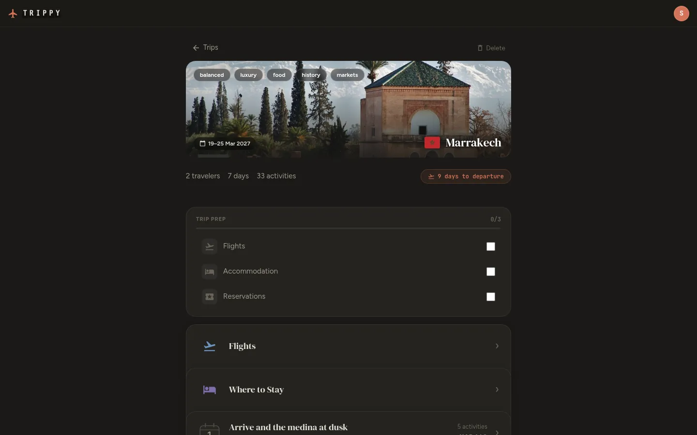</a> The first trip page: a cover photo, a trip prep checklist and one long list of sections.</td>
<td width="13%" valign="top"><a href="images/2026-05-18-c7caadb-landing-phone.webp">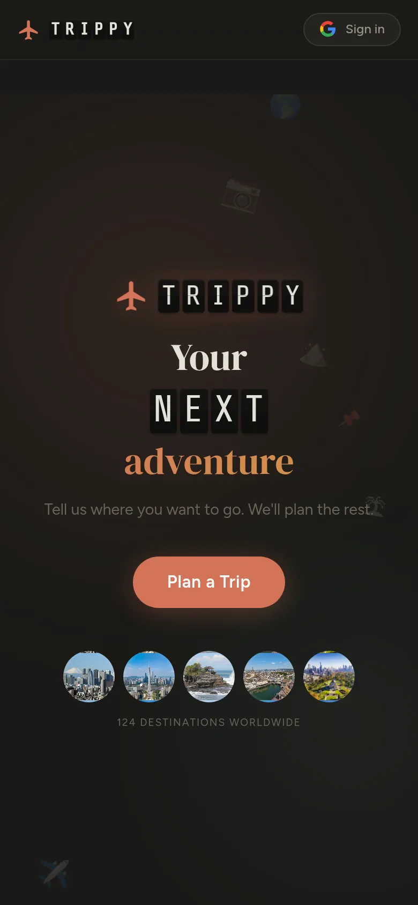</a> The landing page on a phone, with the flip board logo.</td>
</tr></table>

### Accent turns orange

**18 May 2026** (`fdceeea`)

Later the same day the accent colour changed from terracotta to a bold orange, which it has kept since. The same commit added the smart transport wizard.

<table><tr>
<td width="44%" valign="top"><a href="images/2026-05-18-fdceeea-dashboard-desktop.webp">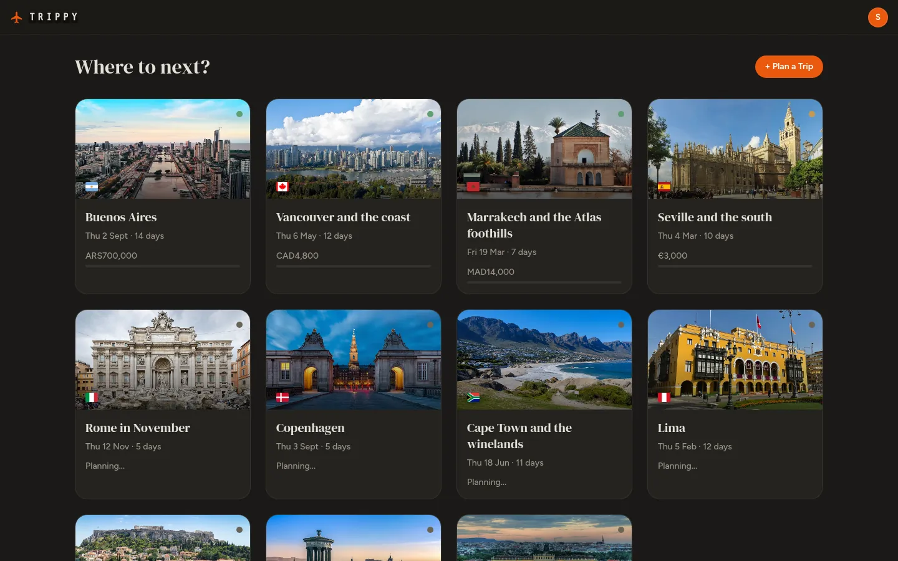</a> The same dashboard a few hours later, now with orange buttons and avatar.</td>
<td width="44%" valign="top"><a href="images/2026-05-18-fdceeea-wizard-step5-desktop.webp">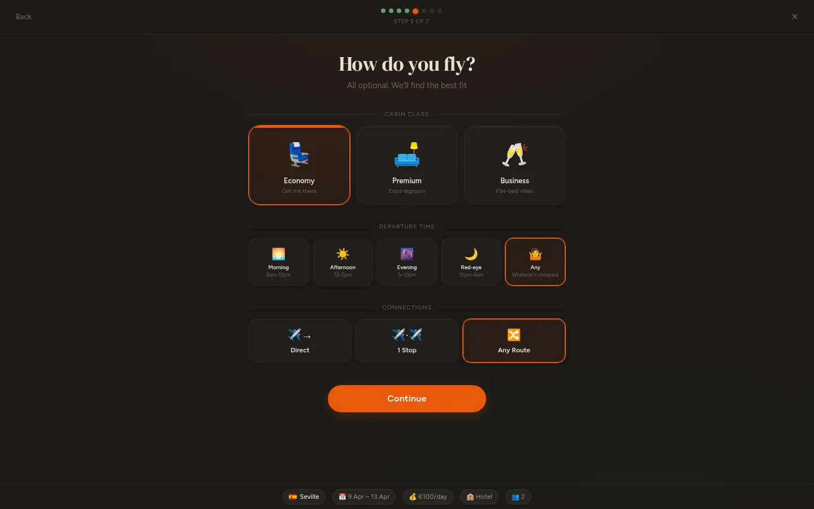</a> Step 5 of the wizard, How do you fly?, with orange selection outlines.</td>
<td width="13%" valign="top"><a href="images/2026-05-18-fdceeea-landing-phone.webp">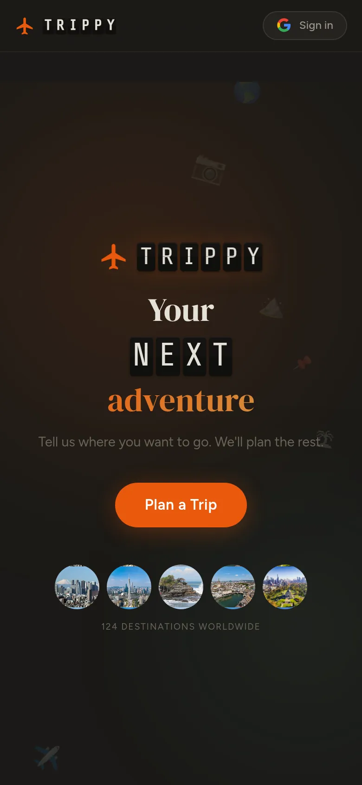</a> The landing page with the orange call to action.</td>
</tr></table>

### Trip page overhaul: tabs, floating headers, spending

**19 May 2026** (`a7083fb`)

The trip page was rebuilt around three tabs: Plan, Spending and Prep. Section headers now float while you scroll, and a spending breakdown shows the estimated trip total with an exchange rate. A sticky footer bar with the trip's key facts had replaced the pills on the cover photo the day before.

<table><tr>
<td width="50%" valign="top"><a href="images/2026-05-19-a7083fb-dashboard-desktop.webp">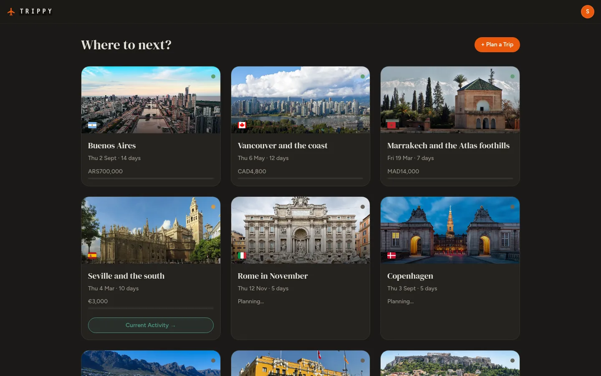</a> The dashboard, now three cards wide.</td>
<td width="50%" valign="top"><a href="images/2026-05-19-a7083fb-trip-desktop.webp">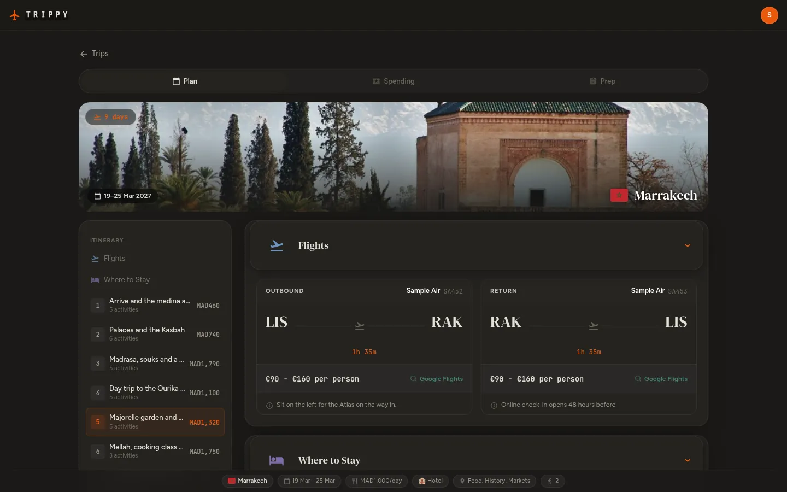</a> The trip page with tabs on top, an itinerary rail on the left and the sticky facts bar at the bottom.</td>
</tr></table>

<table><tr>
<td width="50%" valign="top"><a href="images/2026-05-19-a7083fb-landing-desktop.webp">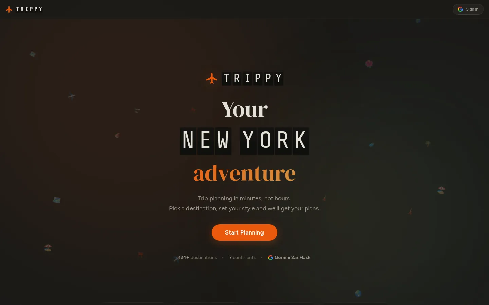</a> The landing page, now reading Start Planning.</td>
<td width="14%" valign="top"><a href="images/2026-05-19-a7083fb-trip-spending-phone.webp">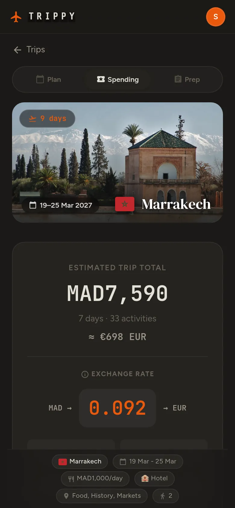</a> The new Spending tab on a phone.</td>
<td width="36%"></td>
</tr></table>

### Admin portal, light mode, sharing, PDF export

**20 May 2026** (`441c227`)

One commit added an admin portal, itinerary sharing, trip editing, a light mode and PDF export. The trip page gained a row of small action buttons and the top bar gained a theme switch.

<table><tr>
<td width="44%" valign="top"><a href="images/2026-05-20-441c227-dashboard-desktop-light.webp">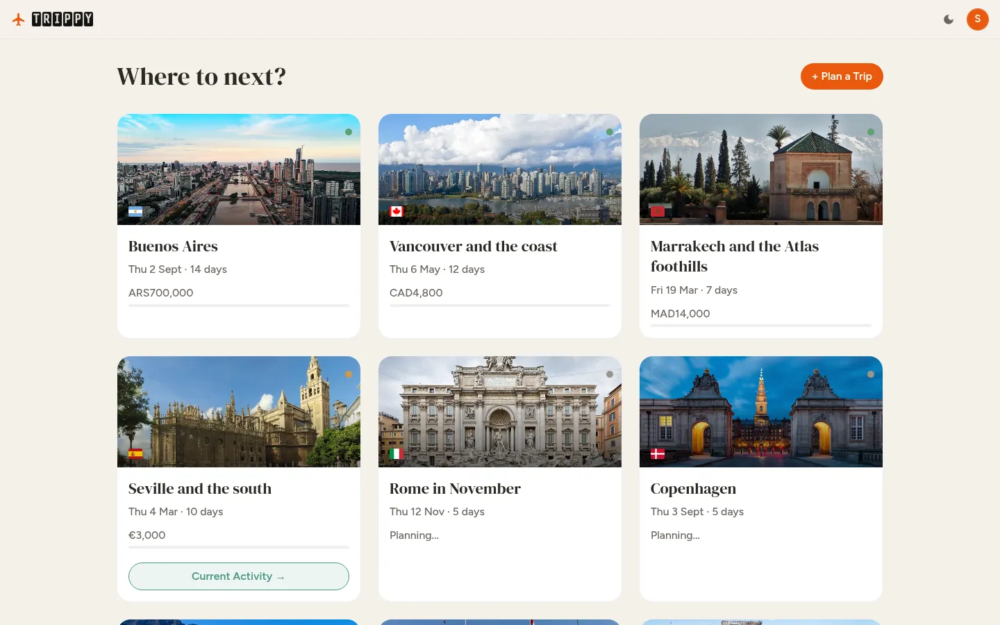</a> The dashboard in the new light mode.</td>
<td width="44%" valign="top"><a href="images/2026-05-20-441c227-admin-desktop.webp">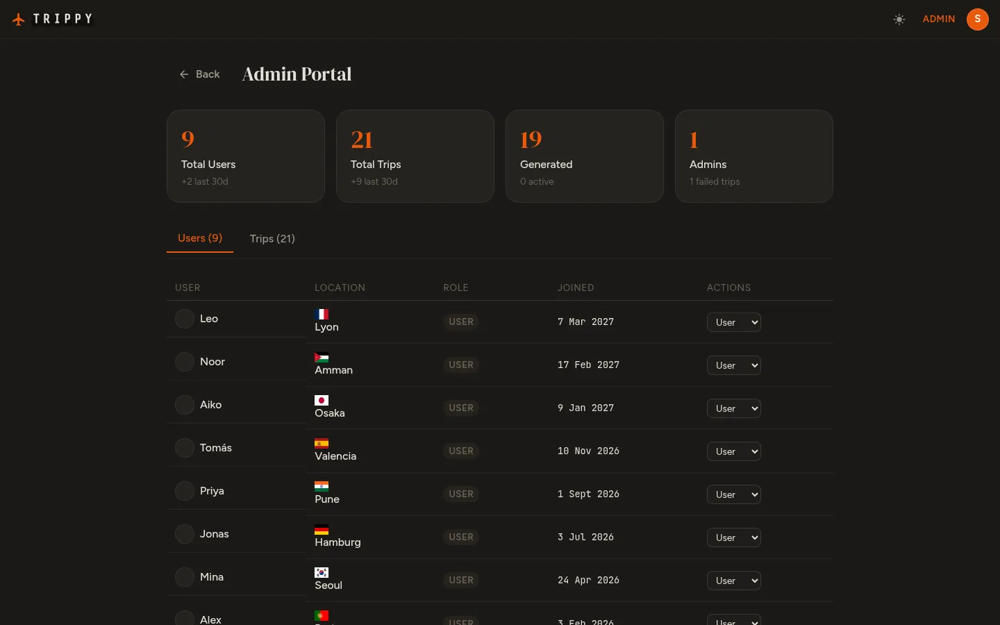</a> The first admin portal: four counters and a table of users.</td>
<td width="13%" valign="top"><a href="images/2026-05-20-441c227-trip-phone.webp">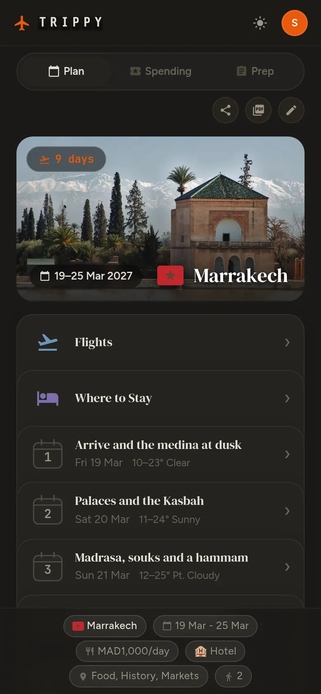</a> The trip page on a phone, with share, export and edit buttons above the cover.</td>
</tr></table>

### Edgy landing, cover-flow wizard, first admin redesign

**23 May 2026** (`cd55ddd`)

The landing page was restyled with a glitch logo, scanlines and an AI badge, and its heaviest animations were then removed for speed. Step 1 of the wizard became a cover flow carousel of destinations, and the step dots became a segmented progress bar. The admin portal was redesigned and gained a Logs tab fed by system-wide logging.

<table><tr>
<td width="50%" valign="top"><a href="images/2026-05-23-cd55ddd-landing-desktop.webp">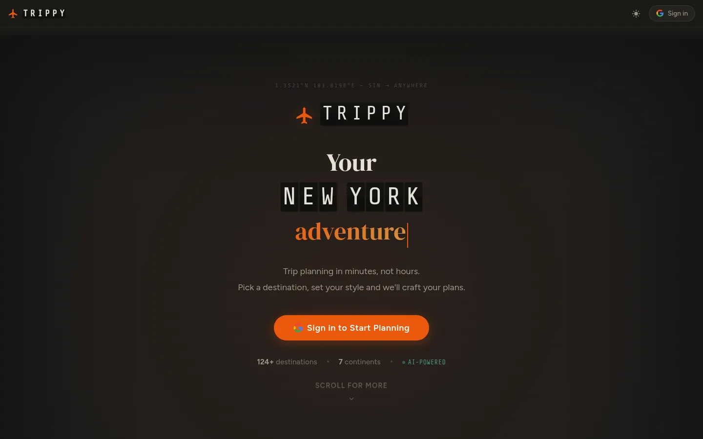</a> The restyled landing page.</td>
<td width="50%" valign="top"><a href="images/2026-05-23-cd55ddd-wizard-desktop.webp">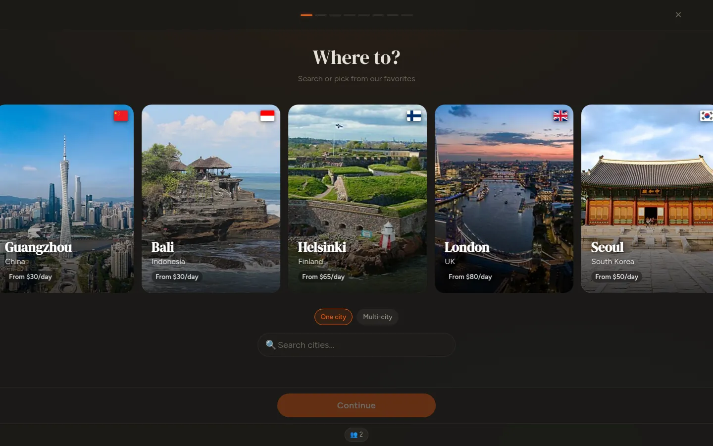</a> Wizard step 1 as a cover flow of destination cards.</td>
</tr></table>

<table><tr>
<td width="50%" valign="top"><a href="images/2026-05-23-cd55ddd-admin-logs-desktop.webp">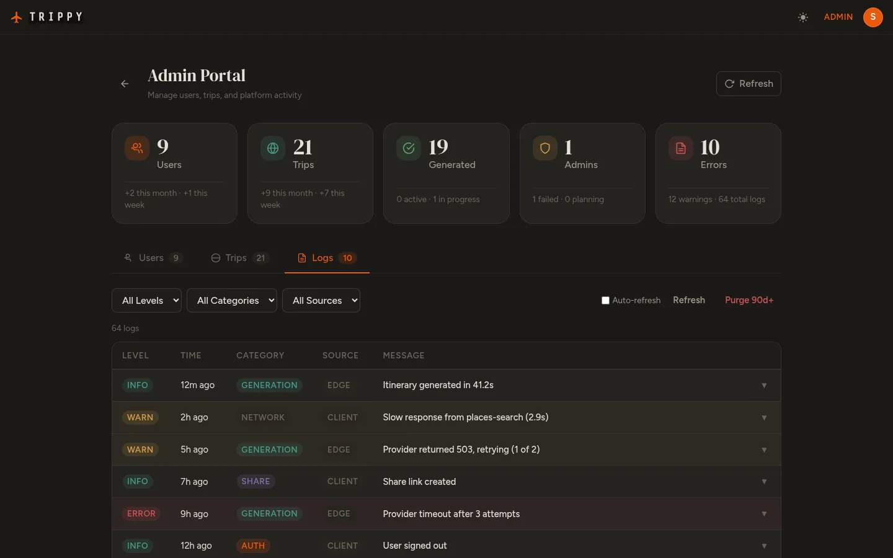</a> The redesigned admin portal on its new Logs tab.</td>
<td width="14%" valign="top"><a href="images/2026-05-23-cd55ddd-wizard-phone.webp">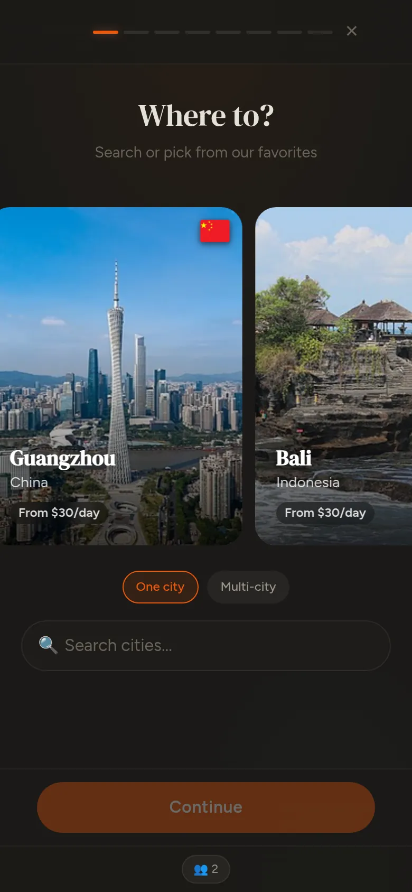</a> The cover flow on a phone, under the segmented progress bar.</td>
<td width="36%"></td>
</tr></table>

## The summer of features

*June to July 2026*

After the first week the work turned to making generation reliable and filling in features. The look stayed recognisably the same while the trip page and dashboard kept gaining parts.

### June UX batches A to D

**6 June 2026** (`a6a25d9`)

Four UX batches landed in one day: accessibility and polish, mobile touch targets and safe areas, error and trust states with better microcopy, and keyboard semantics. Behind the screens, generation moved to an async queue and then to chunked day batches. Trip cards began to show a readable converted amount beside costs in weak currencies.

<table><tr>
<td width="44%" valign="top"><a href="images/2026-06-06-a6a25d9-dashboard-desktop.webp">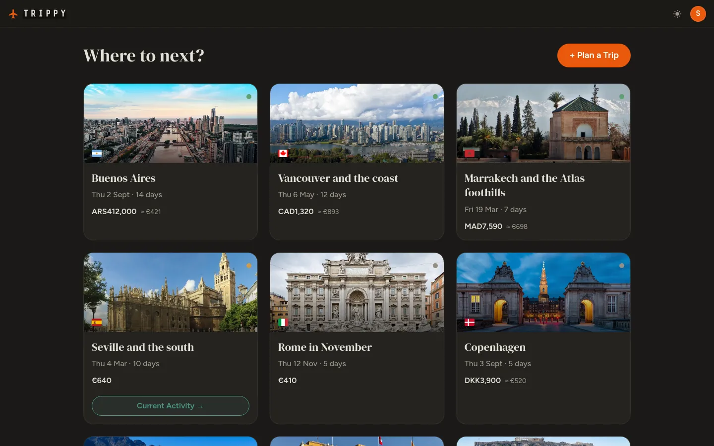</a> The dashboard, with converted amounts beside local costs.</td>
<td width="44%" valign="top"><a href="images/2026-06-06-a6a25d9-trip-desktop.webp">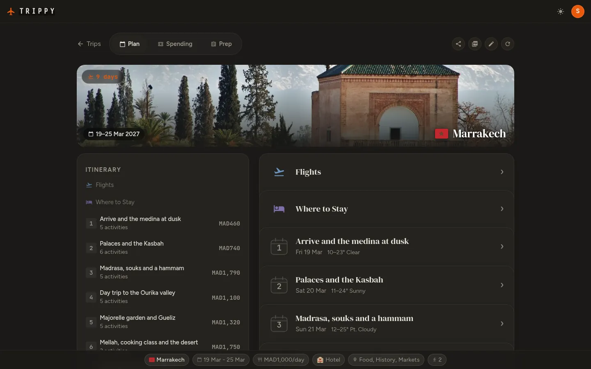</a> The trip page after the batches.</td>
<td width="13%" valign="top"><a href="images/2026-06-06-a6a25d9-dashboard-phone.webp">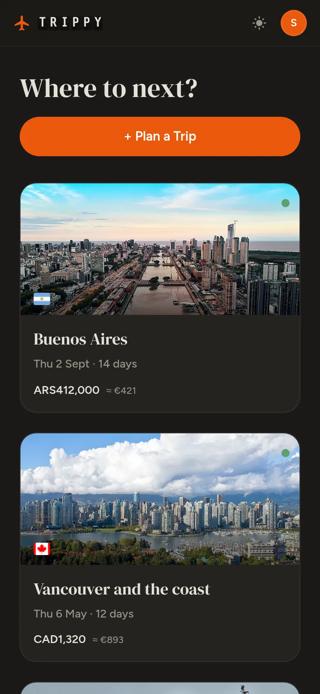</a> The phone dashboard with a full width Plan a Trip button.</td>
</tr></table>

### Towns tab, GT Eesti font, boarding-pass footer

**11 June 2026** (`da158d1`)

A fourth tab, Towns, showed a flip card for every neighbourhood on the route, with photos. The body font had changed to GT Eesti a few days earlier, and the site gained a footer styled like a boarding pass. The same day brought uniform borders and a pass of animation polish across the app.

<table><tr>
<td width="50%" valign="top"><a href="images/2026-06-11-da158d1-trip-towns-desktop.webp">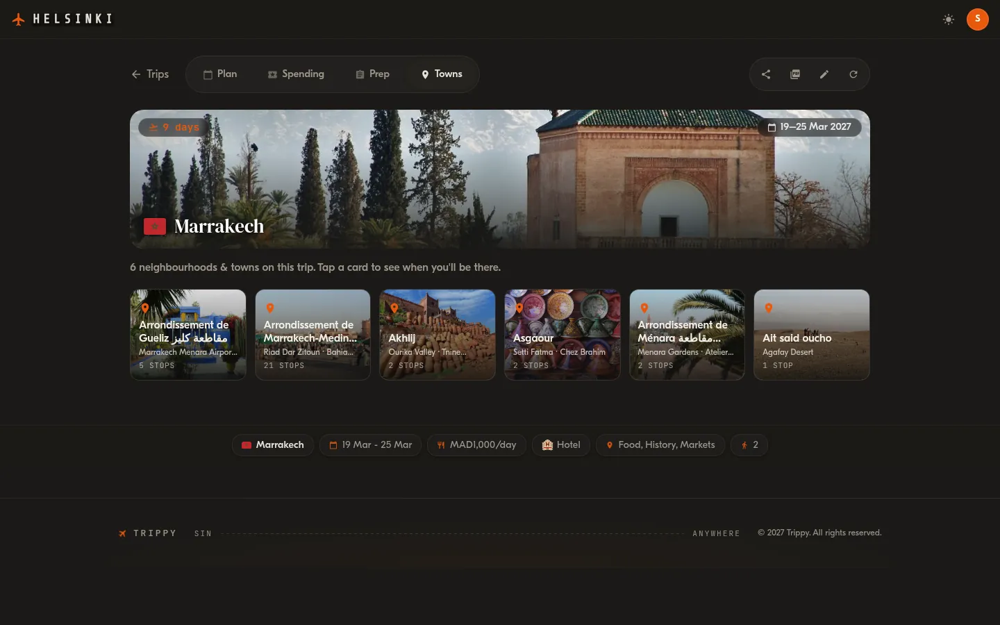</a> The Towns tab: one photo card per neighbourhood, and the new footer below.</td>
<td width="14%" valign="top"><a href="images/2026-06-11-da158d1-trip-towns-phone.webp">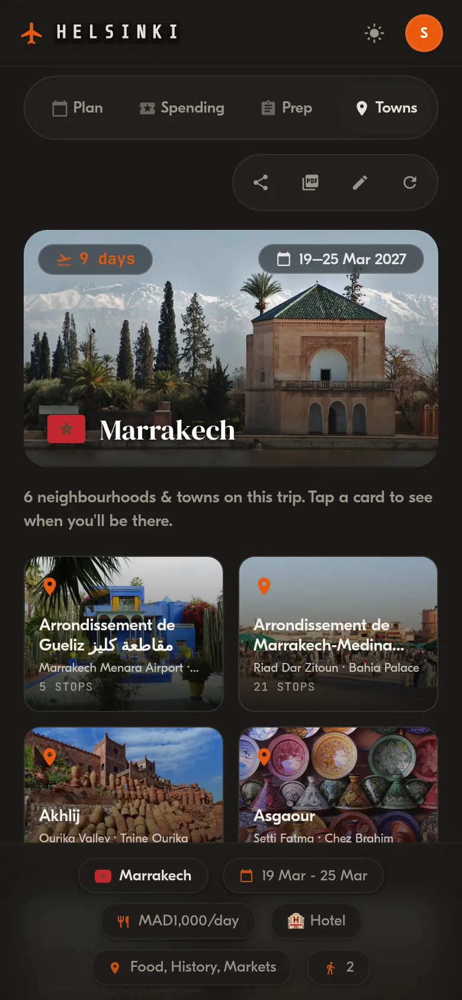</a> Towns on a phone.</td>
<td width="14%" valign="top"><a href="images/2026-06-11-da158d1-trip-phone.webp">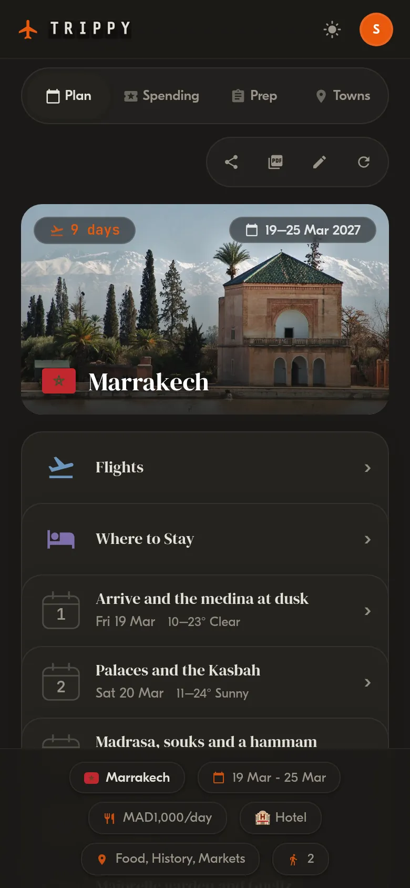</a> The trip page with four tabs and the GT Eesti body font.</td>
<td width="21%"></td>
</tr></table>

### Square-screen mode, Discover, stored venue photos

**15 June 2026** (`798e448`)

A square-screen mode was added for short, square displays: it turns long pages into cards that you page through. The Towns tab became Discover with roomier cards. Trip photos were now resolved once and stored, instead of being looked up on every visit.

<table><tr>
<td width="50%" valign="top"><a href="images/2026-06-15-798e448-dashboard-desktop.webp">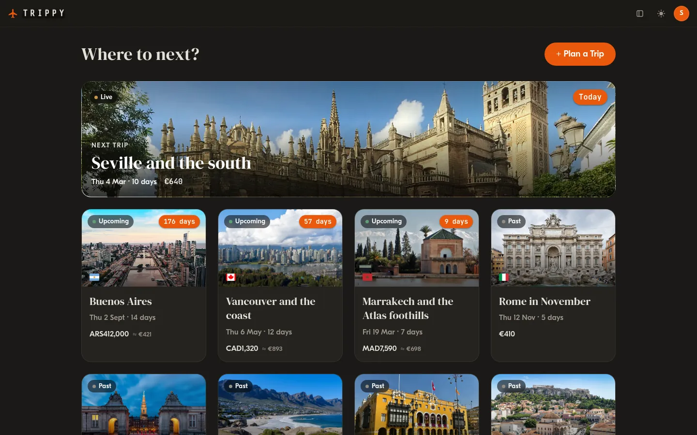</a> The dashboard at this point, with a wide next trip card and countdown badges.</td>
<td width="50%" valign="top"><a href="images/2026-06-15-798e448-trip-discover-desktop.webp">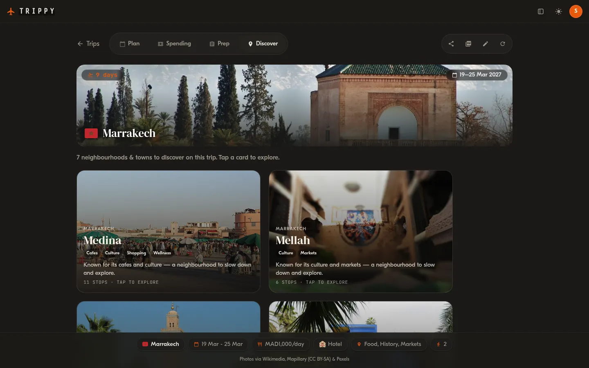</a> The Discover tab with larger neighbourhood cards.</td>
</tr></table>

<table><tr>
<td width="31%" valign="top"><a href="images/2026-06-15-798e448-dashboard-square-phone.webp">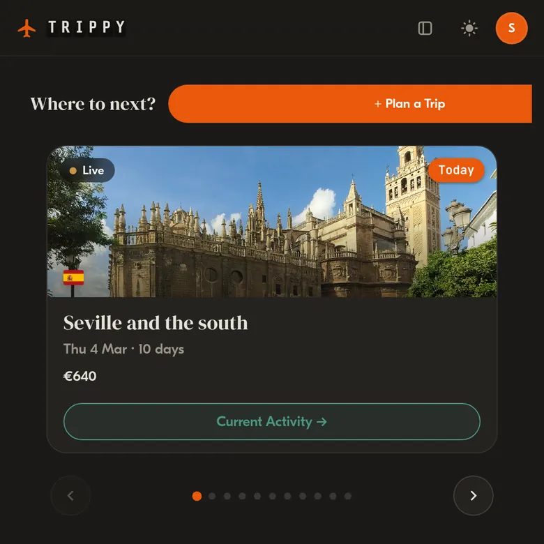</a> Square-screen mode: the dashboard as one card per page.</td>
<td width="31%" valign="top"><a href="images/2026-06-15-798e448-trip-square-phone.webp">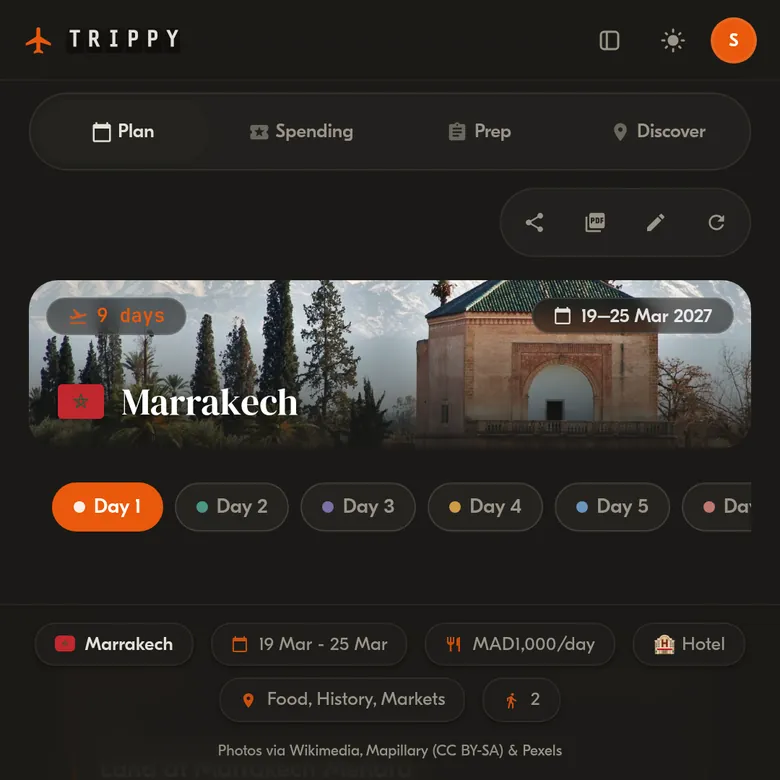</a> Square-screen mode on a trip: days become chips.</td>
<td width="38%"></td>
</tr></table>

### User-feedback batch: chat edits, alternatives, collaboration

**5 July 2026** (`3ea4832`)

A batch built from user feedback added editing a trip by chat, alternatives for a stop, and collaborators who can edit a shared trip. The last Google-billed services were replaced with free ones in the same sitting.

<table><tr>
<td width="50%" valign="top"><a href="images/2026-07-05-3ea4832-trip-share-desktop.webp">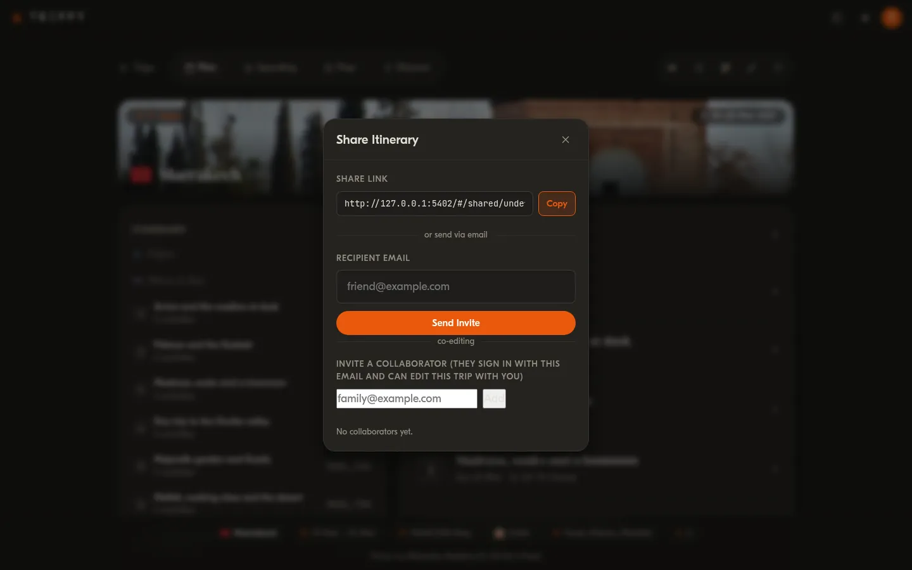</a> The share dialog, now with an invite for a collaborator.</td>
<td width="14%" valign="top"><a href="images/2026-07-05-3ea4832-trip-chat-phone.webp">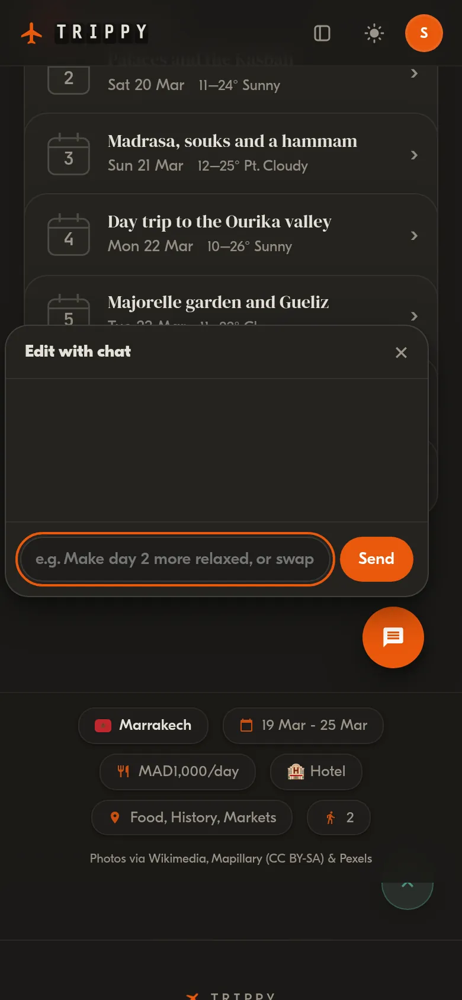</a> Edit with chat, opened from a floating button.</td>
<td width="14%" valign="top"><a href="images/2026-07-05-3ea4832-day-phone.webp">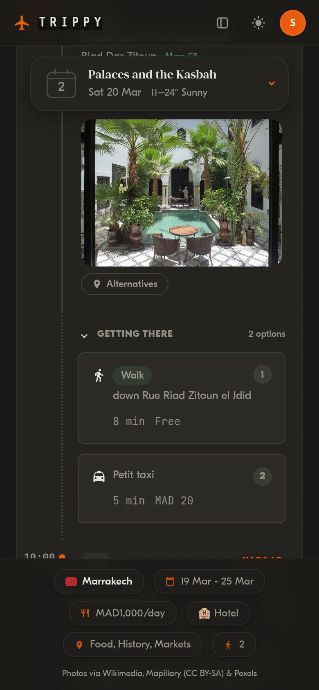</a> A day on a phone, with the new Alternatives chip under a stop.</td>
<td width="21%"></td>
</tr></table>

## The November review

*14 to 17 November 2026*

After a quiet autumn, a large review release shipped in mid November. It was followed within days by entry requirements, a better generation flow and real venue photos.

### November review release

**15 November 2026** (`4c79f83`)

The review release added guided trip import, booked flights, per-stay dates and booking deadlines, along with faster trip loading and security hardening. The itinerary chat was renamed Trippy Concierge and given a bell. Flight cards were made calmer, and all times moved to a 12 hour format with AM and PM.

<table><tr>
<td width="50%" valign="top"> The dashboard with the new Import trip link beside Plan a Trip.</td>
<td width="14%" valign="top"><a href="images/2026-11-15-4c79f83-flights-phone.webp">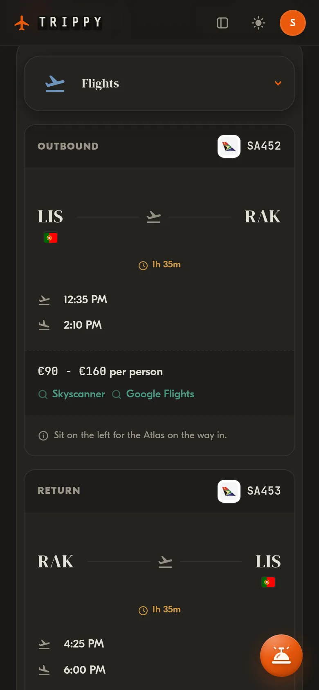</a> The calmer flight card, with 12 hour times and an airline mark.</td>
<td width="14%" valign="top"><a href="images/2026-11-15-4c79f83-stay-phone.webp">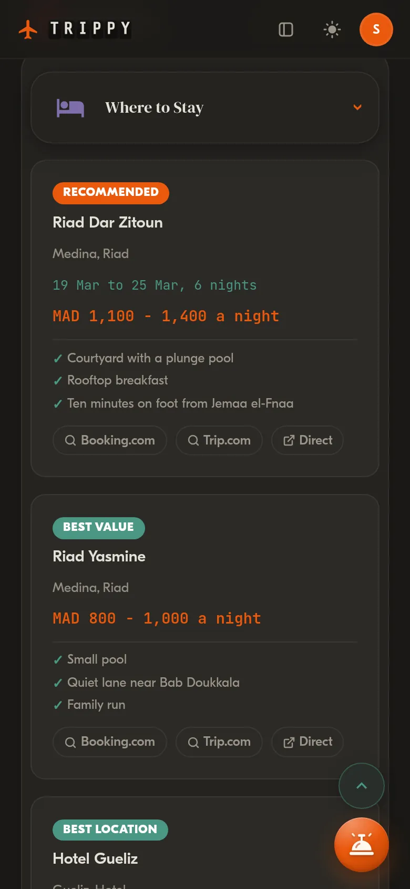</a> Where to Stay with dates per stay, and the concierge bell in the corner.</td>
<td width="21%"></td>
</tr></table>

### Generation popup, transport card, entry requirements

**15 November 2026** (`3f5f2eb`)

One commit added a generation popup, a transport card, entry requirements and booked flights. Entry requirements appear as a new section on the trip page and depend on the passports in the group. The entry data for Europe and Asia was fact-checked in follow-up commits the same day.

<table><tr>
<td width="50%" valign="top"><a href="images/2026-11-15-3f5f2eb-entry-desktop.webp">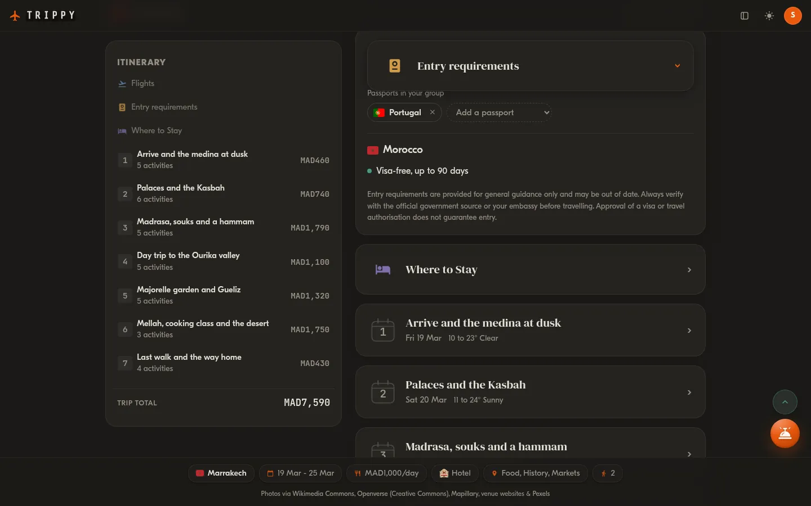</a> The new Entry requirements section on the trip page.</td>
<td width="14%" valign="top"><a href="images/2026-11-15-3f5f2eb-entry-phone.webp">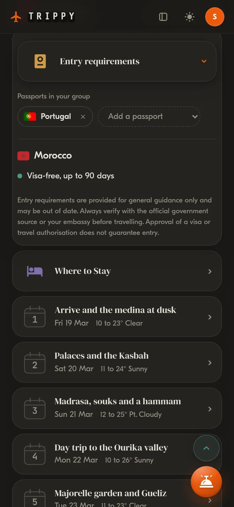</a> Entry requirements on a phone, with the passport picker.</td>
<td width="36%"></td>
</tr></table>

### Venue photos and the designed placeholder

**17 November 2026** (`f7c524d`)

Stops without a photo now show a designed placeholder instead of a street view image. Venue photos began to come from Google Maps and web search as well as the free sources, are fetched only by the server worker, and are checked by a vision model before use. Scrolling to the end of a day now opens the next day.

<table><tr>
<td width="50%" valign="top"><a href="images/2026-11-17-f7c524d-day-desktop.webp">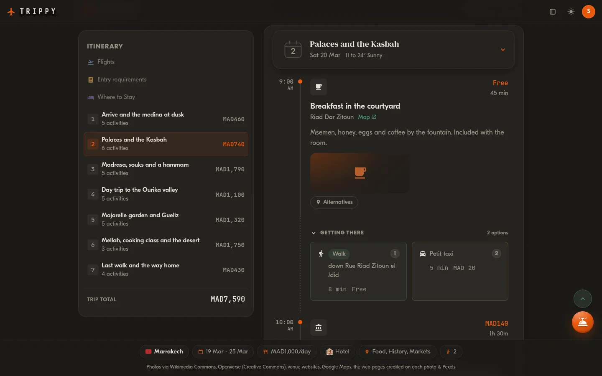</a> A stop with the designed placeholder where no photo was found.</td>
<td width="14%" valign="top"><a href="images/2026-11-17-f7c524d-day-photo-phone.webp">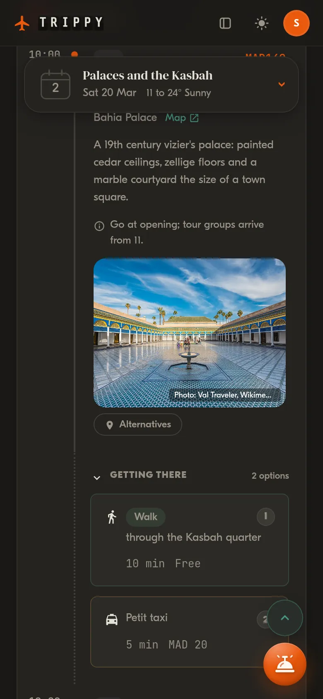</a> A stop with a credited venue photo.</td>
<td width="14%" valign="top"><a href="images/2026-11-17-f7c524d-day-phone.webp">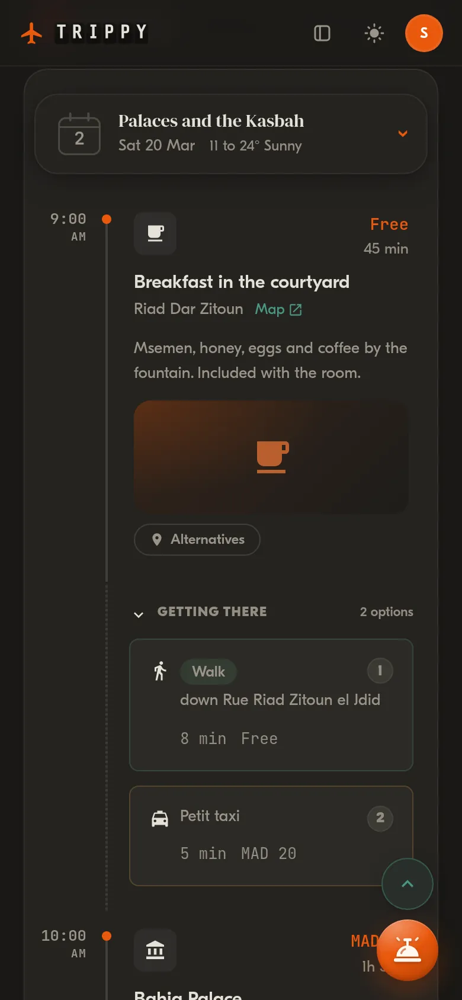</a> The placeholder on a phone.</td>
<td width="21%"></td>
</tr></table>

## The three views

*21 November 2026*

The biggest visual change since the first week came in a single commit. The dashboard and trip page can now be shown in three different views, chosen in a new Settings page.

### Three views: Departures, Concierge, Atlas, plus Settings and the Atlas page

**21 November 2026** (`6c7e4fe`)

The app gained three selectable views called Departures, Concierge and Atlas, a Settings page where you choose between them, and a separate Atlas page that maps every place in your plans. The top bar gained Trips and Atlas links. The screenshots here show the Atlas view.

<table><tr>
<td width="50%" valign="top"><a href="images/2026-11-21-6c7e4fe-dashboard-desktop.webp">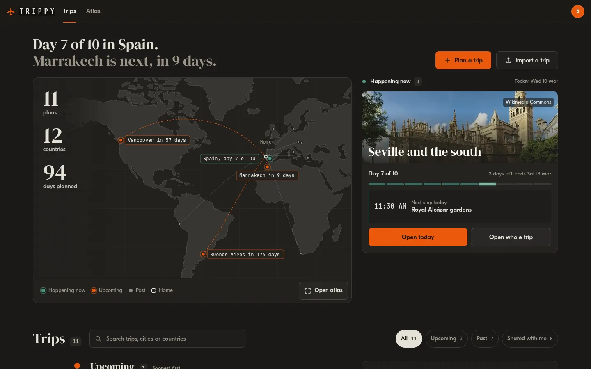</a> The dashboard in the Atlas view: a world map of plans beside the trip happening now.</td>
<td width="50%" valign="top"><a href="images/2026-11-21-6c7e4fe-settings-desktop.webp">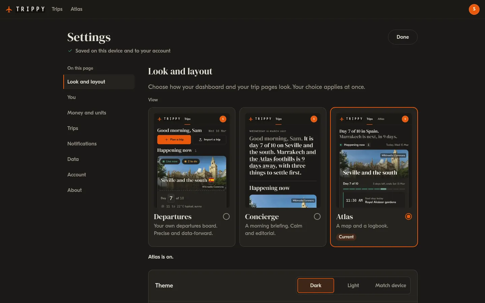</a> The new Settings page, with the three views as picture cards.</td>
</tr></table>

<table><tr>
<td width="50%" valign="top"><a href="images/2026-11-21-6c7e4fe-atlas-desktop.webp">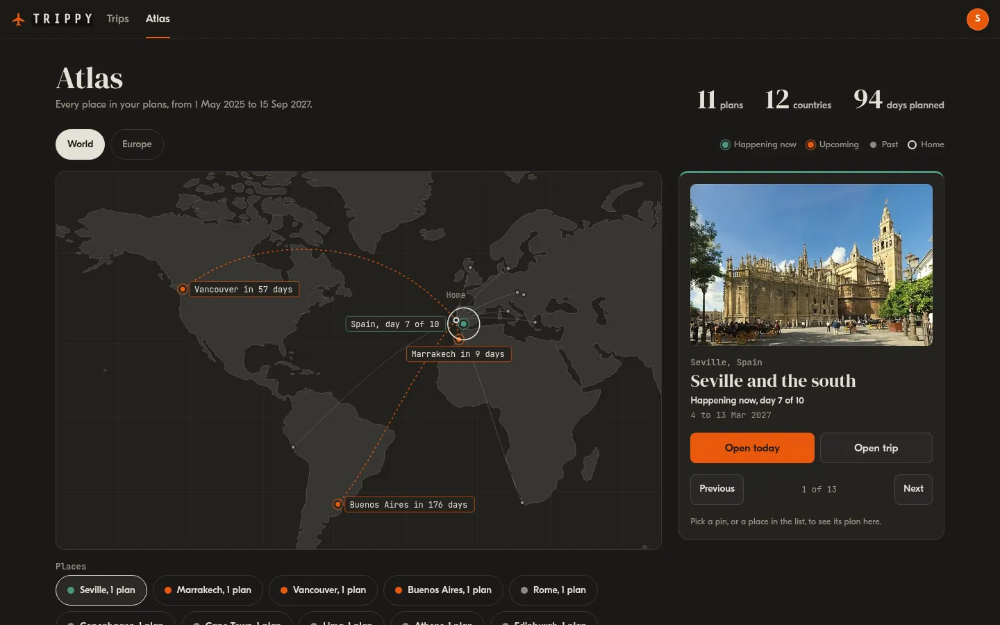</a> The Atlas page: every place in your plans on one map.</td>
<td width="14%" valign="top"><a href="images/2026-11-21-6c7e4fe-trip-phone.webp">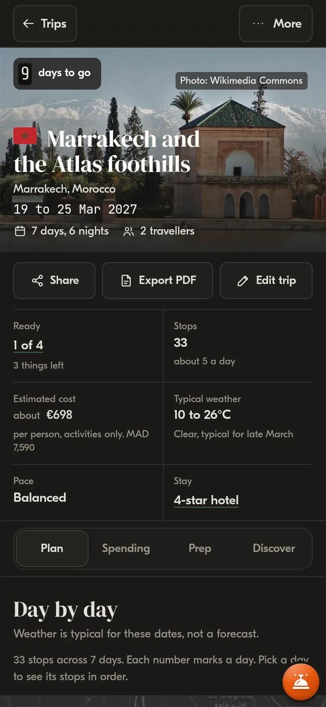</a> The Atlas trip page on a phone, with a facts panel under the cover.</td>
<td width="36%"></td>
</tr></table>

## Polish and site pages

*21 to 22 November 2026*

The two days after the redesign were spent on many small style commits, mostly to the Atlas view. The site then gained its public pages and the admin page was redone.

### Atlas polish, round one

**21 November 2026** (`7785db8`)

Coloured side borders were removed throughout. The Atlas trip page gained a day panel, a Day by day board, an essentials row and a facts panel, and its day bar is now pinned under the top bar. On the dashboard the columns were made level.

<table><tr>
<td width="44%" valign="top"><a href="images/2026-11-21-7785db8-dashboard-desktop.webp">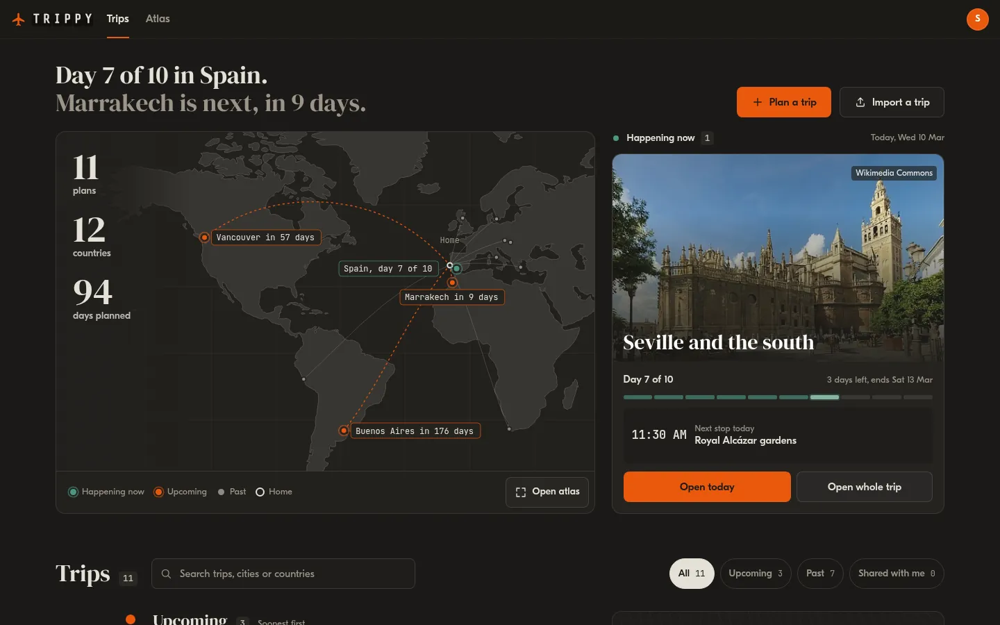</a> The Atlas dashboard with the trip card as tall as the map.</td>
<td width="44%" valign="top"><a href="images/2026-11-21-7785db8-trip-desktop.webp">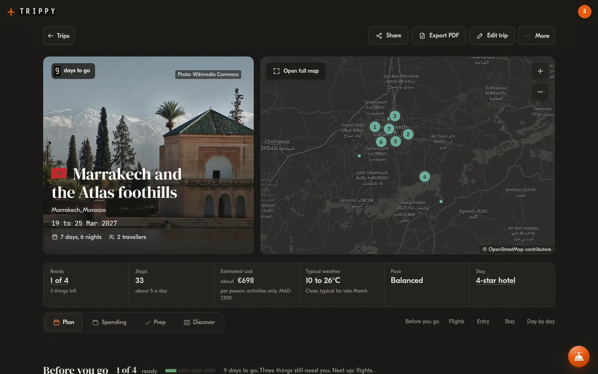</a> The Atlas trip page: cover and map side by side above a facts panel.</td>
<td width="13%" valign="top"><a href="images/2026-11-21-7785db8-trip-phone.webp">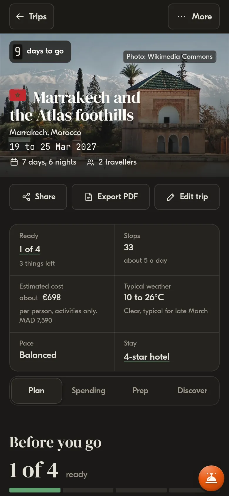</a> The same page on a phone, leading into Before you go.</td>
</tr></table>

### Atlas polish, round two

**22 November 2026** (`315e27a`)

A long run of style commits tidied the Atlas view. Trips and Atlas became one control beside the account, the search box and next departure card were lined up with the columns, and countdowns became flap tiles reading IN and a number of days. On the Atlas page the list of places now runs across the full width.

<table><tr>
<td width="44%" valign="top"> The dashboard with the new Trips and Atlas control and a wide search box.</td>
<td width="44%" valign="top"><a href="images/2026-11-22-315e27a-atlas-desktop.webp">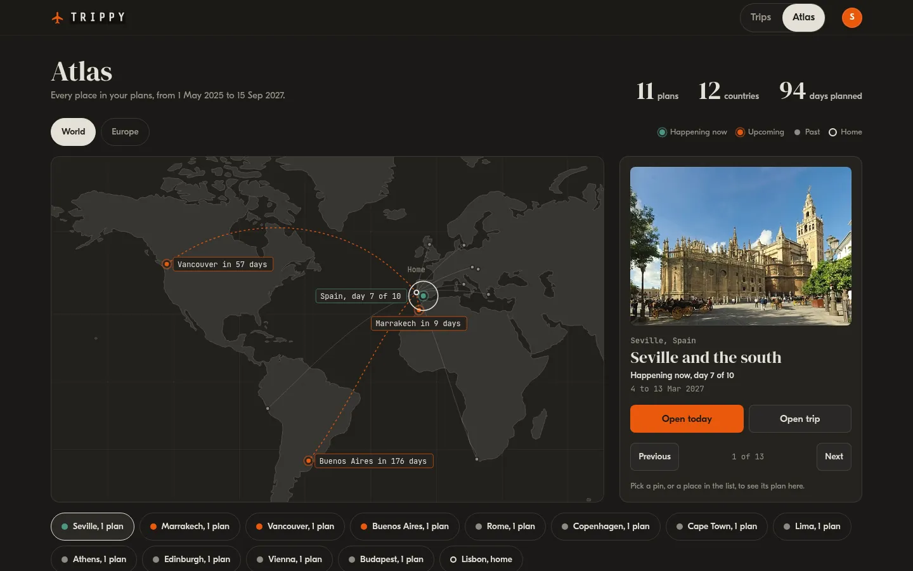</a> The Atlas page with places across the full width.</td>
<td width="13%" valign="top"><a href="images/2026-11-22-315e27a-atlas-phone.webp">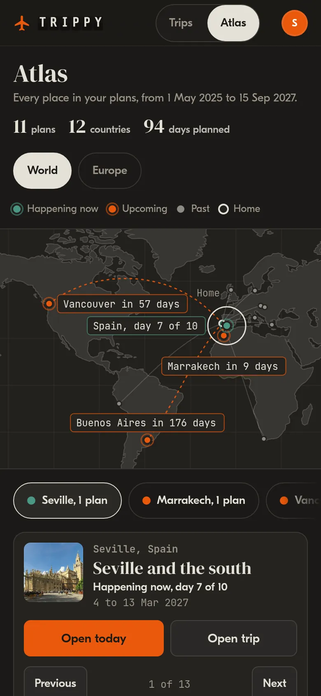</a> The Atlas page on a phone.</td>
</tr></table>

### Site footer, About, Privacy, Terms, four languages

**22 November 2026** (`cafd6d6`)

The site gained a footer and three pages: About, Privacy policy and Terms of use, each in four languages. A related commit added self-serve account deletion and rewrote the policy. The page headers sit on a drawn Atlas world map.

<table><tr>
<td width="50%" valign="top"><a href="images/2026-11-22-cafd6d6-about-desktop.webp">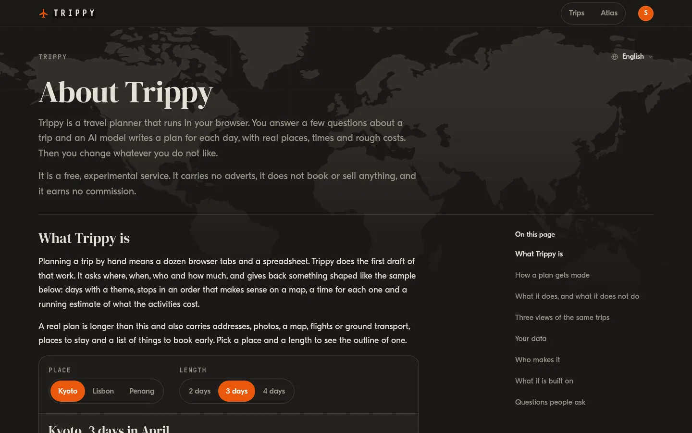</a> The About page, with the world map behind its header.</td>
<td width="14%" valign="top"><a href="images/2026-11-22-cafd6d6-about-phone.webp">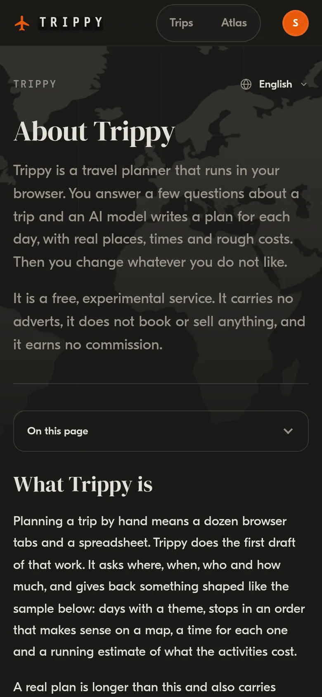</a> About on a phone, with the language picker.</td>
<td width="14%" valign="top"><a href="images/2026-11-22-cafd6d6-landing-phone.webp">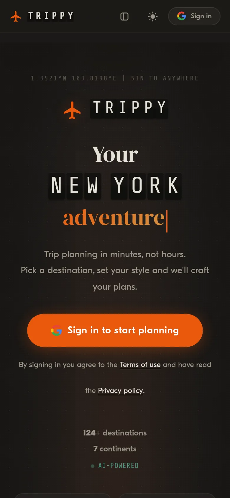</a> The landing page, now linking to the Terms of use and Privacy policy.</td>
<td width="21%"></td>
</tr></table>

### Admin redesigned as an operator's console

**22 November 2026** (`b0b1136`)

The admin page was redesigned as an operator's console. It opens on an overview with counters, a chart of sign-ups and trips per week, a list of things that need attention and a generation health panel.

<table><tr>
<td width="50%" valign="top"> The new admin overview.</td>
<td width="14%" valign="top"> The admin overview on a phone, with section tabs.</td>
<td width="36%"></td>
</tr></table>

## Today

*22 November 2026*

This is the app as it stands at the last commit covered here. The newest features are mostly dialogs and flows, so little of them shows on the main screens.

### Today: Word import, plan comparison, the concierge chat, concierge button in the trip bar

**22 November 2026** (`3a5e170`)

You can now import a Word document or pasted plan text as a trip, and compare an imported plan with a Trippy plan side by side. The concierge answers questions, notes bookings, changes stays and adds notes to stops, and its button moved into the trip bar after More. Step 1 of the wizard now has its search box directly under the title.

<table><tr>
<td width="39%" valign="top"> The dashboard today.</td>
<td width="39%" valign="top"> The trip page today, with the concierge bell in the bar at top right.</td>
<td width="11%" valign="top"> The trip bar on a phone: Trips, More and the concierge button.</td>
<td width="11%" valign="top"> Wizard step 1 with the search box under the title.</td>
</tr></table>

## How the screenshots were made

Each past commit was checked out into its own folder, built and run locally against invented sample data, with the browser clock fixed so that countdowns and dates stay the same from one milestone to the next. Desktop shots are 1440 pixels wide and phone shots are 780 pixels wide. The trips, people and prices shown are not real.

What is missing:

- Screens that need a live AI or server answer: the generation popup, the transport card from 15 November, the concierge chat in use, Word import and plan comparison.
- The Departures and Concierge views. Only the Atlas view was captured after 21 November.
- The PDF export, the profile pages, and the Privacy and Terms pages.
- The dashboard where it looked the same as at the milestone before. It is shown only when it had changed.
- Square-screen mode after June, and light mode on most screens.
